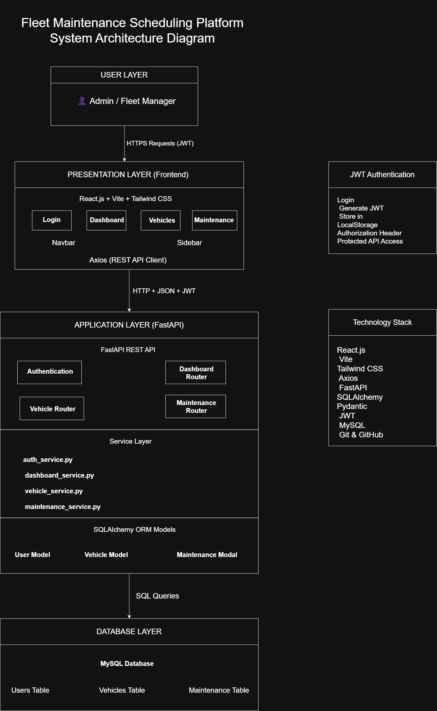
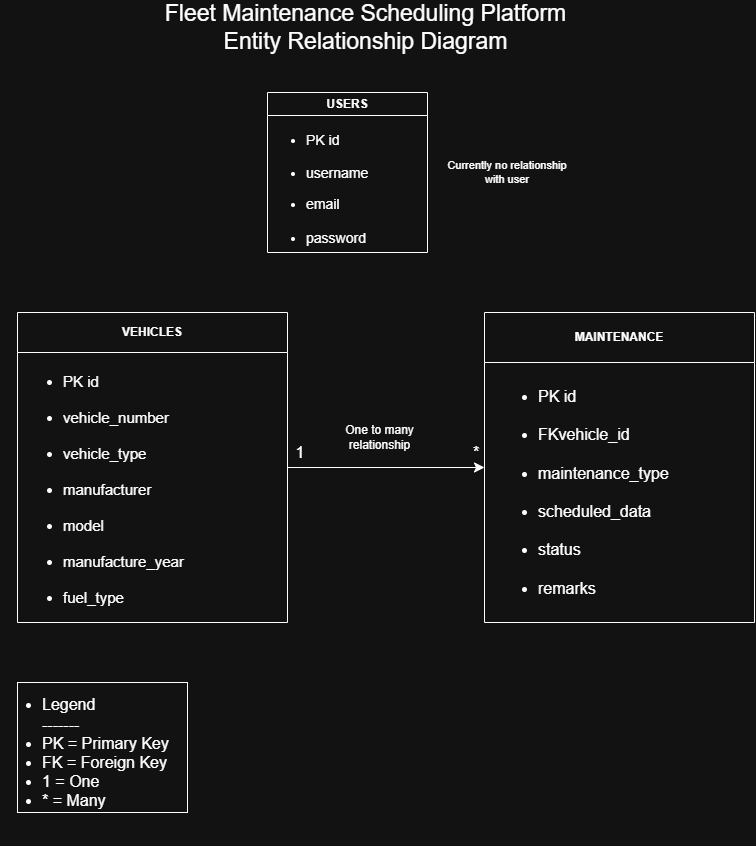
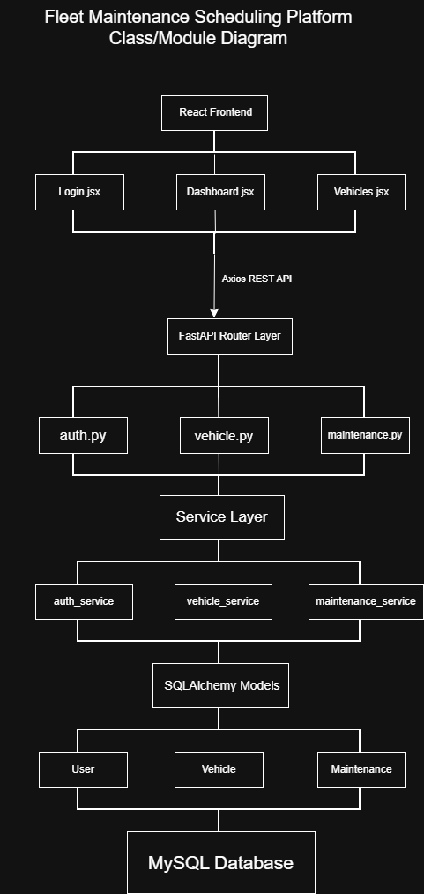
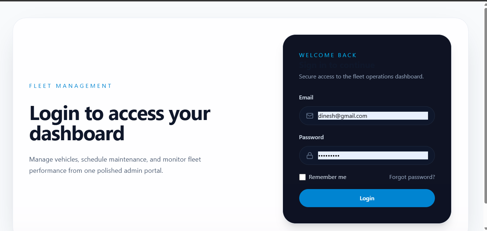
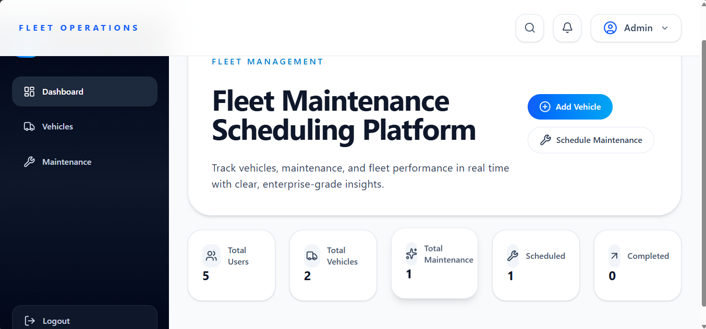
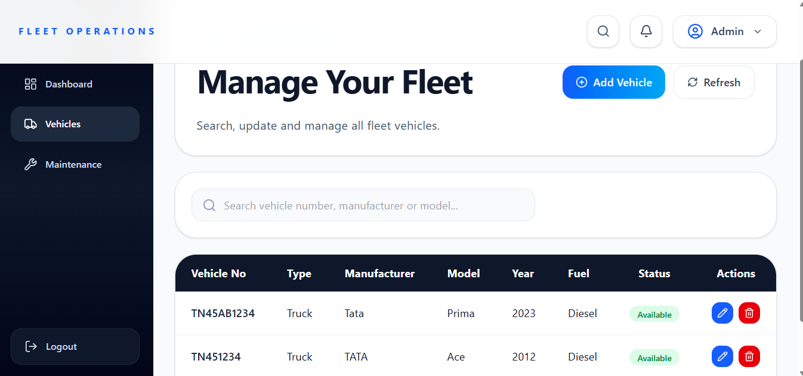
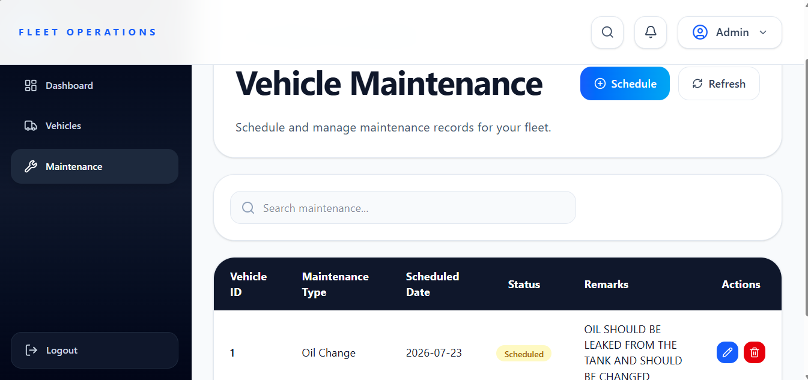

# 🚗 Fleet Maintenance Scheduling Platform

<p align="center">
  
</p>

<p align="center">


</p>

<p align="center">

A modern web-based Fleet Maintenance Scheduling Platform built using **React.js**, **FastAPI**, and **MySQL**.

</p>

---

# 📖 Overview

Fleet Maintenance Scheduling Platform is a web application that helps organizations efficiently manage their fleet operations.

It enables administrators to:

- 🚗 Manage Vehicles
- 🔧 Schedule Maintenance
- 📊 Monitor Dashboard Statistics
- 🔐 Secure User Authentication
- 📄 Maintain Maintenance Records

---

# ✨ Features

| Module | Features |
|---------|----------|
| 🔐 Authentication | JWT Login, Protected Routes |
| 📊 Dashboard | Fleet Statistics & Summary |
| 🚗 Vehicle Management | Add, Edit, Delete, View Vehicles |
| 🔧 Maintenance | Schedule, Update & Delete Maintenance |
| 🎨 UI | Responsive Dashboard with Modern Design |

---

# 🛠 Technology Stack

| Layer | Technology |
|--------|------------|
| Frontend | React.js, Vite, Tailwind CSS |
| Backend | FastAPI, SQLAlchemy, Pydantic |
| Database | MySQL |
| Authentication | JWT |
| API Testing | Swagger UI |
| Version Control | Git & GitHub |

---

# 🏗 System Architecture

<p align="center">

</p>

---

# 🗄 Entity Relationship Diagram

<p align="center">

</p>

---

# 📚 Class Diagram

<p align="center">

</p>

---

# 📂 Project Structure

```text
Fleet-Maintenance-Scheduling-Platform
│
├── backend/
├── frontend/
├── docs/
│   ├── diagrams/
│   └── screenshots/
├── README.md
└── .gitignore
```

---

# ⚙ Installation

## Clone Repository

```bash
git clone https://github.com/Dinesh200703/Fleet-Maintenance-Scheduling-Platform.git
```

## Backend

```bash
cd backend

python -m venv .venv

# Windows
.\.venv\Scripts\activate

pip install -r requirements.txt

uvicorn app.main:app --reload
```

Backend URL

```
http://127.0.0.1:8000
```

---

## Frontend

```bash
cd frontend

npm install

npm run dev
```

Frontend URL

```
http://localhost:5173
```

---

# 🚀 Running the Project

1. Start the MySQL server.
2. Run the FastAPI backend.
3. Run the React frontend.
4. Open **http://localhost:5173**.
5. Login with valid credentials.

---

# 📑 API Documentation

Swagger UI is available at:

```
http://127.0.0.1:8000/docs
```

Available APIs:

- Authentication
- Dashboard
- Vehicles
- Maintenance

---

# 📷 Application Screenshots

## 🔐 Login



---

## 📊 Dashboard



---

## 🚗 Vehicle Management



---

## 🔧 Maintenance



---

## 📄 Swagger API


---

# 🚀 Future Enhancements

- Predictive Maintenance
- Email Notifications
- GPS Tracking
- Fleet Analytics
- Mobile Application
- Cloud Deployment
- Role-Based Access Control

---

# 👨‍💻 Author

**Dinesh R**

B.Tech – Artificial Intelligence and Data Science

GitHub: https://github.com/Dinesh200703

---

# 📄 License

This project is developed for educational and academic purposes.